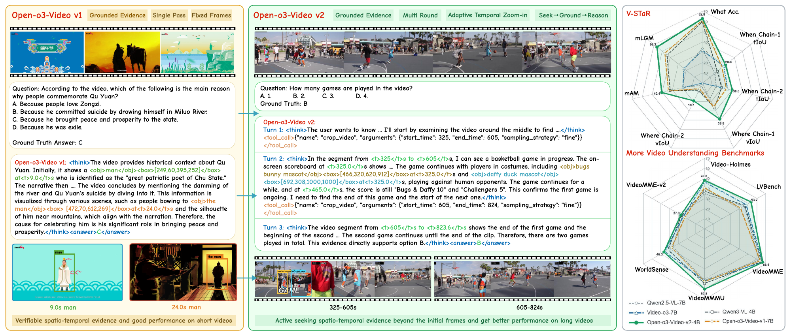
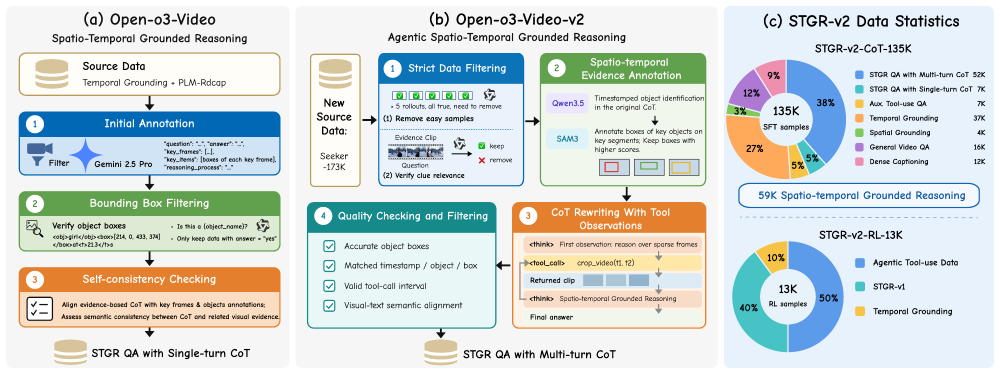
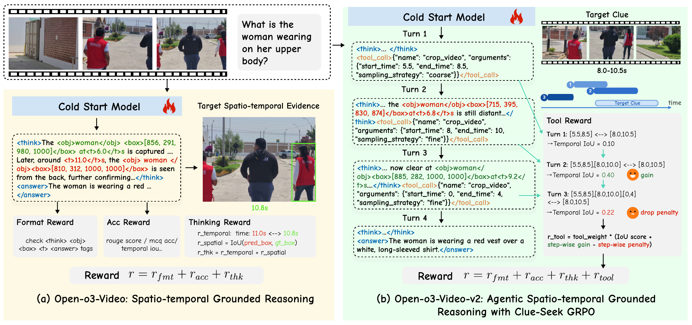
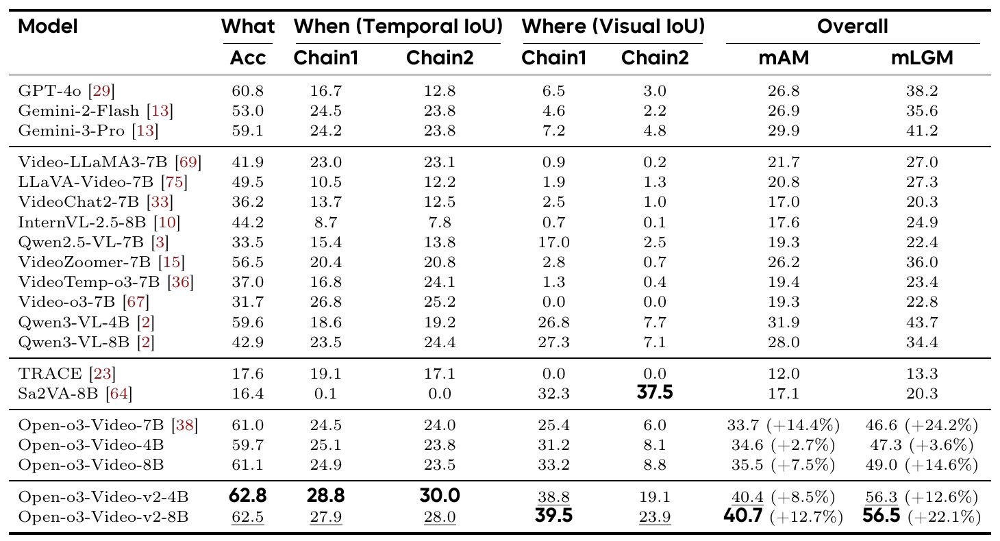
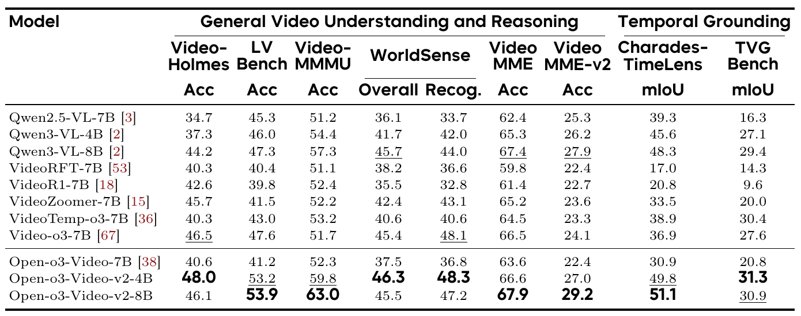
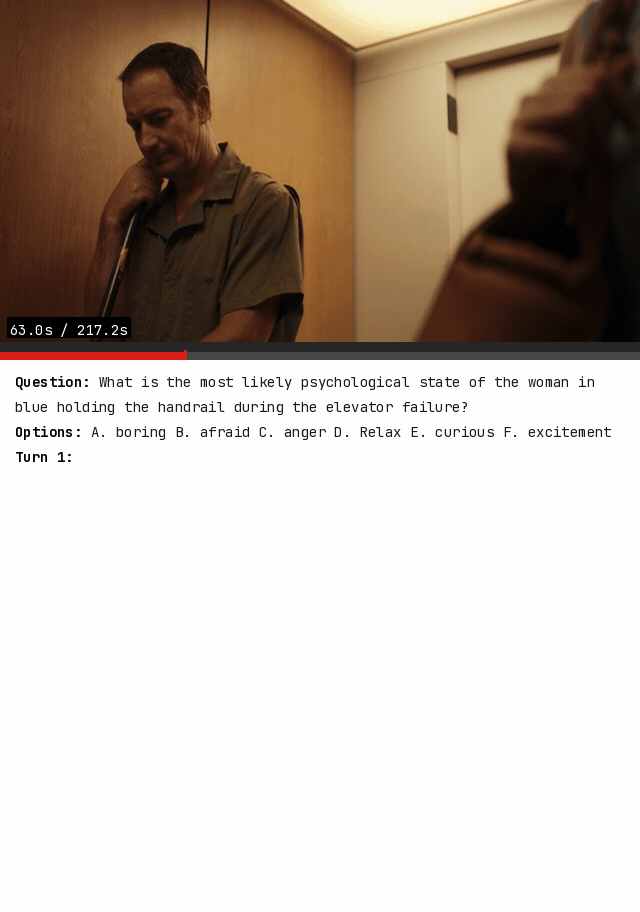
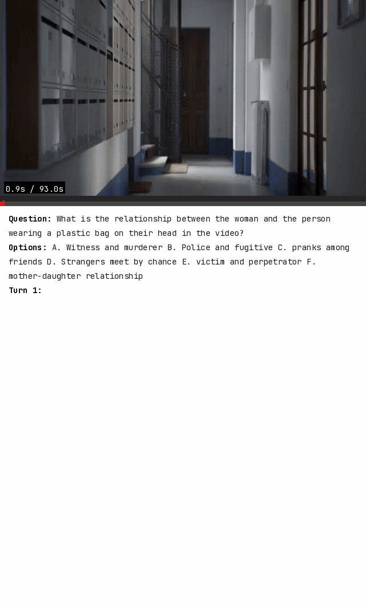
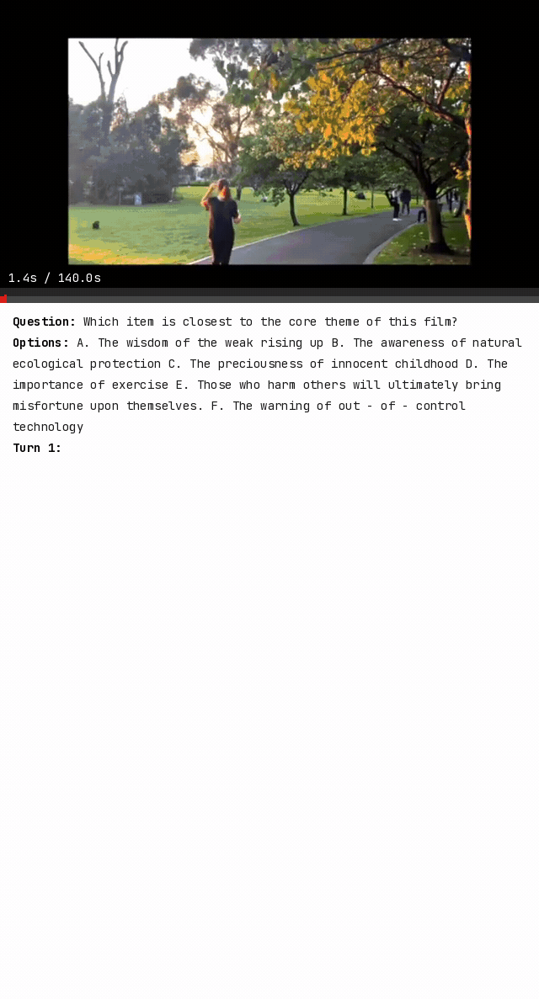
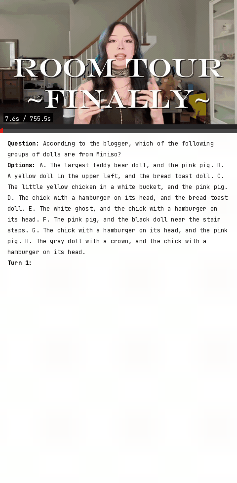
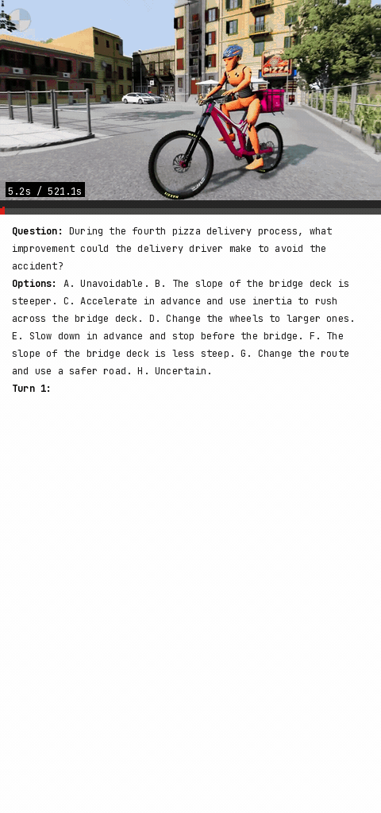

# Open-o3-Video-v2: Seek, Ground, and Reason with Verifiable Spatio-Temporal Evidence

Jiahao Meng\*, Zhongyuan Bao\*, Yue Tan, Haiquan Wen, Renrui Zhang, Anna Wang, Jason Li, Yanwei Fu, Yunhai Tong, and Ming-Hsuan Yang.

\* Equal contribution.

[[Paper](https://arxiv.org/pdf/2610.xxxxx)] · [[Project Page](https://msalab-pku.github.io/projects/Open-o3-Video-v2)] · [[4B Model](https://modelscope.cn/models/FDUBay/Open-o3-Video-v2-4B)] · [[Training Annotations](https://modelscope.cn/datasets/FDUBay/Open-o3-Video-v2-data)]

**From grounded reasoning over fixed frames to an agentic system that actively seeks, grounds, and reuses visual evidence.** Open-o3-Video-v2 identifies missing clues, inspects relevant clips, anchors observations to moments and objects, and carries that evidence forward to refine its reasoning and produce a verifiable answer. This repository provides supervised fine-tuning (SFT), reinforcement learning (RL), and evaluation code.

## Method

**Agentic evidence-grounded reasoning.** The model starts with sparse video observations. When evidence is missing, it calls `crop_video` to inspect a relevant interval. It grounds the retrieved moments and objects, then uses them in its next reasoning step.

**Multi-turn grounded data.** **STGR-v2-CoT-135K** includes **52K** multi-turn trajectories linking tool calls, returned frames, grounded reasoning, and final answers. **STGR-v2-RL-13K** provides informative examples for policy optimization. The 13K count is the approximate training sample count; the released JSON files contain larger source pools.

**Clue-Seek GRPO (CS-GRPO).** RL optimizes complete interaction trajectories. It rewards final clue coverage and useful gains from new observations. It penalizes excessive, repeated, fragmented, or uninformative retrieval. Answer accuracy, output format, and grounded thinking remain part of the objective.

## Models

| Release | Link |
| --- | --- |
| Open-o3-Video-v2-4B | [ModelScope](https://modelscope.cn/models/FDUBay/Open-o3-Video-v2-4B) |
| Open-o3-Video-v2-8B | [ModelScope](https://modelscope.cn/models/FDUBay/Open-o3-Video-v2-8B) |
| Open-o3-Video-v2-4B-SFT | [ModelScope](https://modelscope.cn/models/FDUBay/Open-o3-Video-v2-4B-SFT) |
| Open-o3-Video-v2-8B-SFT | [ModelScope](https://modelscope.cn/models/FDUBay/Open-o3-Video-v2-8B-SFT) |

## Results

Open-o3-Video-v2-8B achieves **40.7% mAM and 56.5% mLGM on V-STaR**. Meanwhile, both the 4B and 8B models demonstrate consistent performance improvements across a wide range of general video understanding benchmarks.

## Demos

<table>
  <tr><td></td><td></td></tr>
  <tr><td></td><td></td></tr>
  <tr><td></td><td></td></tr>
</table>

## Quick Start

### 1. Environment

SFT, RL, and evaluation use separate environments. Follow the setup instructions for [SFT](SFT/README.md#environment-and-data), [RL](RL/README.md#single-node-run), and [evaluation](Eval/README.md#setup). Configure any required model-hub credentials locally; no keys are included in this repository.

### 2. Data preparation

Download the annotations and source videos, then prepare the training inputs as described in [Data](DATA.md).

### 3. Supervised fine-tuning

Download the [Qwen3-VL-4B-Instruct](https://modelscope.cn/models/Qwen/Qwen3-VL-4B-Instruct) base model and run the retained 135K recipe:

~~~bash
# download the model
modelscope download --model Qwen/Qwen3-VL-4B-Instruct --local_dir ./models/Qwen3-VL-4B-Instruct
# sft
MODEL_PATH="$PWD/models/Qwen3-VL-4B-Instruct" \
PREPARED_DIR="$PWD/SFT/prepared" \
OUTPUT_DIR="$PWD/SFT/checkpoints/openo3-video-v2-4b-sft" \
NPROC_PER_NODE=8 bash SFT/train.sh configs/qwen3vl/open-o3-video/qwen3_sft_mix_multi_image_135k.yaml
~~~

The 4B config above is the default in `SFT/train.sh`. The 8B recipe uses [Qwen3-VL-8B-Instruct](https://modelscope.cn/models/Qwen/Qwen3-VL-8B-Instruct) and `SFT/configs/qwen3vl/open-o3-video/qwen3_sft_mix_multi_image_135k_8b.yaml`. See [SFT/README.md](SFT/README.md).

### 4. Reinforcement learning

RL starts from an SFT model in Transformers format. Download the released [4B SFT model](https://modelscope.cn/models/FDUBay/Open-o3-Video-v2-4B-SFT), or export a checkpoint from step 3. The default recipe uses eight GPUs and the Video-o3 split created above:

~~~bash
# download the model
modelscope download --model FDUBay/Open-o3-Video-v2-4B-SFT --local_dir ./models/openo3-video-v2-4b-sft
# rl
MODEL_PATH="$PWD/models/openo3-video-v2-4b-sft" \
DATA_ROOT="$PWD/data/annotations" \
MEDIA_ROOT="$PWD/data/media" \
bash RL/scripts/start_openo3_train.sh
~~~

See [RL/README.md](RL/README.md) for the two-node Ray launcher and path overrides. The released GRPO reward weights and optimizer settings remain in the training script.

### 5. Evaluation

Download the [4B model](https://modelscope.cn/models/FDUBay/Open-o3-Video-v2-4B) locally. Obtain each benchmark's annotations and media from its original release.

~~~bash
cd Eval
# download the model
modelscope download --model FDUBay/Open-o3-Video-v2-4B --local_dir ./models/Open-o3-Video-v2-4B
# eval
VIDEO_HOLMES_DATASET_DIR="$PWD/data/benchmarks/Video-Holmes/test_Video-Holmes.json" \
VAL_DATASET_SAMPLE=1 bash scripts/eval_openo3video_v2_4b.sh video_holmes
~~~

Remove `VAL_DATASET_SAMPLE` for a full run. The evaluator supports all nine benchmarks in the paper; see [Eval/README.md](Eval/README.md) for dataset keys, paths, and tool settings.

## License and Citation

The project code is released under [Apache-2.0](LICENSE). The bundled verl code retains its [license](RL/verl/LICENSE) and [notice](RL/verl/Notice.txt). Source videos and benchmarks retain their original licenses.

~~~bibtex
@article{meng2026openo3v2,
  title={Open-o3-Video-v2: Seek, Ground, and Reason with Verifiable Spatio-Temporal Evidence},
  author={Meng, Jiahao and Bao, Zhongyuan and Tan, Yue and Wen, Haiquan and Zhang, Renrui and Wang, Anna and Li, Jason and Fu, Yanwei and Tong, Yunhai and Yang, Ming-Hsuan},
  journal={arXiv preprint arXiv:2610.xxxxx},
  year={2026}
}
~~~

## Acknowledgements

This work builds on [MS-SWIFT](https://github.com/modelscope/ms-swift), [verl](https://github.com/volcengine/verl), and the video datasets listed in [Data Preparation](DATA.md).
